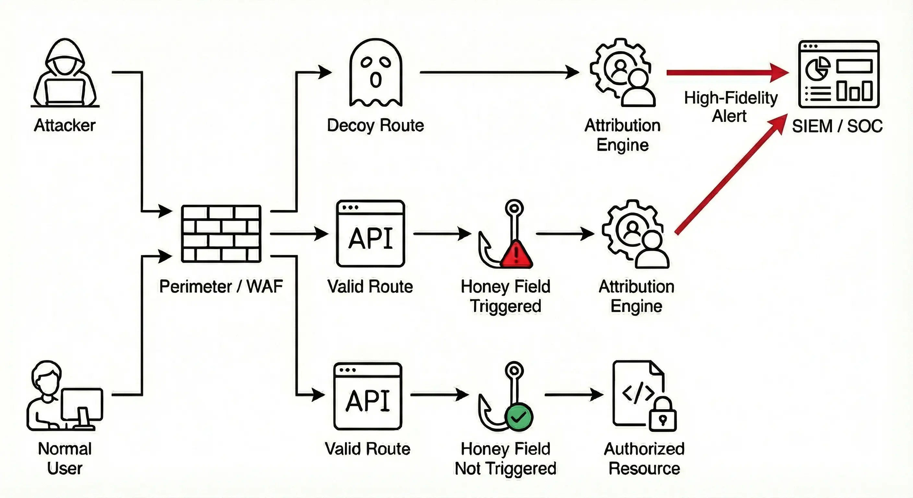

## **trappsec** 

trappsec is an open-source framework that helps developers detect attackers who probe API business logic. By embedding realistic decoy routes and honey fields that are difficult to distinguish from real API constructs, attackers are nudged to authenticate — converting reconnaissance into actionable security telemetry.

> Built for the 1% of people who actually look at their security alerts, **and** the 99% who just like the idea of having them.


[Read the Docs](https://trappsec.dev/overview/) • [Ultra Quickstart](https://trappsec.dev/ultra-quickstart/) • [Threat Model](https://trappsec.dev/threat-model/) • [Production](https://trappsec.dev/production/)

<br>



---

### Core Concepts

* **Decoy Routes:** These are "ghost" endpoints that sit outside your real logic but look authentic. By planting dummy references in your client-side code, you can bait attackers into hitting these traps, allowing you to monitor their behavior via custom static or dynamic responses that adapt to the authentication status.

* **Honey Fields:** Non-functional parameters embedded within legitimate API endpoints that act as invisible tripwires. You can bait attackers by including them as hidden form fields with static values or leveraging existing "read-only" attributes that appear in GET responses as honey fields that trigger alerts if an attacker attempts to modify them via POST or PUT requests.

* **Identity Attribution:** Framework hooks allow you to link a request to an authenticated user identity. You can also map traps to a specific **intent** (Privilege Escalation, Reconnaissance etc). Put together, you get high-fidelity alerts that security teams can respond to quickly and more effectively.

---

### Best Practices

*  **Require Authentication:** In an internet that is mostly harmless but increasingly full of people and scanners (mostly scanners) poking things they shouldn't, you don’t want to get buried with noise. Use unauthenticated template responses like (401, Unauthorized) to guide them to probe with authentication.

*  **Blend In:** A trap should look exactly like a normal part of your API. A good trap should look like a mundane, standard - perhaps even tedious part of your API. If it looks "too good to be true", attackers will ignore it. Design traps to catch people trying to understand or manipulate your business logic.

---

### Alerting

trappsec can integrate directly into your existing workflows. Events are written to your standard logging handlers by default, but can be configured to also integrate into **OpenTelemetry** for observability or **Webhooks** to trigger automated responses or notify security teams.

---

### Let Your Coding Agent Do It

Three agent skills turn your coding agent into a security engineer for your own app. Each writes its changes in your app's own code, adds no dependency, works on any stack, and reports through **OpenTelemetry**, which the app must already have set up with logs. All three share one event schema, so their events line up in your SIEM.

* **`add-deception`** designs honey fields and decoy routes that match your API's conventions, built from the same authentication, loaders and validation as the routes beside them, plus frontend lures that look like your team wrote them. It verifies that every tripwire fires and that no real user can ever trigger one.
* **`add-detection`** turns validation your app already does into detections: it finds the checks that reject inputs and states no real client can produce (values the UI never offers, totals that disagree with the server, steps out of order, another tenant's IDs) and makes each one report who tried, without changing any response.
* **`add-auditing`** records the security-relevant actions taken in your product (sign-ins, role changes, sharing, exports, API keys, settings, deletions) as domain events with actor, credential, resource and outcome.

**Claude Code:**

```
/plugin marketplace add trappsec-dev/trappsec
/plugin install trappsec@trappsec
```

Then ask it to *add deception*, *add detection* or *add audit logging* to your app, or run `/trappsec:add-deception`, `/trappsec:add-detection` or `/trappsec:add-auditing`.

**Other agents** that support [Agent Skills](https://agentskills.io): copy the skills in [`plugins/trappsec/skills`](plugins/trappsec/skills) into your agent's skills directory.

---

### Supported Frameworks

<table>
  <thead>
    <tr>
      <th>Language</th>
      <th>Framework</th>
    </tr>
  </thead>
  <tbody>
    <tr>
      <td rowspan="7"><b>Python</b></td>
      <td>Flask</td>
    </tr>
    <tr><td>FastAPI</td></tr>
    <tr><td>Starlette</td></tr>
    <tr><td>Litestar</td></tr>
    <tr><td>Django</td></tr>
    <tr><td>Sanic</td></tr>
    <tr><td>Tornado</td></tr>
    <tr>
      <td rowspan="6"><b>Node.js</b></td>
      <td>Express</td>
    </tr>
    <tr><td>NestJS</td></tr>
    <tr><td>Fastify</td></tr>
    <tr><td>Hapi</td></tr>
    <tr><td>Koa</td></tr>
    <tr><td>Hono</td></tr>
    <tr>
      <td rowspan="4"><b>Go</b></td>
      <td>net/http</td>
    </tr>
    <tr><td>Gin</td></tr>
    <tr><td>Echo</td></tr>
    <tr><td>chi, gorilla/mux and other <code>http.Handler</code> routers</td></tr>
  </tbody>
</table>

> Missing your favorite framework? [Raise a request here](https://github.com/trappsec-dev/trappsec/discussions/new?category=feature-requests).

---

### Support
Community support is available via GitHub issues and discussions.  
For commercial support or services, email **nikhil@ftfy.co**.


